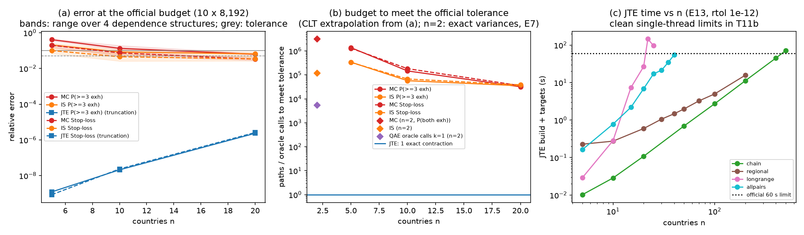

# Results reported in the Technical Proposal — produced by the full engine (NOT included in this repository)

> **Read this first.** The numbers on this page were produced by our full joint-tail engine, which is **not** part of this public repository and therefore **cannot be reproduced from this repository**. They are copied verbatim from the full engine's result tables and run logs (snapshot 2026-11-25) so that the panel can match them to the Technical Proposal. No number here is new. Everything that *this* repository reproduces is in [`results/`](results/) and listed in the README. The full engine will be made available to the evaluation panel on request, under confidentiality, in Phase 2.

Labels: all engine runs are classical CPU (`classical_cpu`). The QAE rows are **resource estimates only**; no quantum circuit was executed on hardware. Synthetic n-country portfolios use the official ADB marginals; they are not official benchmarks.

### R1. Scaling: chain of n countries (ADB marginals, 3-year term, T = USD 40m x n)  [source: full-engine table T3]

| n | annual states | MPS time | max bond | dense exact time | check |
|---:|---:|---:|---:|---:|---|
| 2 | 10^2 | 3 ms | 9 | 4 ms | dense diff 1e-11; MC 2M paths: max abs z = 1.25 (5/5 targets observable) |
| 3 | 10^3 | 28 ms | 9 | 99 ms | dense diff 8e-12 |
| 4 | 10^4 | 173 ms | 9 | 6492 ms | dense diff 1e-11 |
| 5 | 10^5 | 216 ms | 9 | not run (10^n memory/time) | MC 2M paths: max abs z = 1.27 (4/5 targets observable) |
| 6 | 10^6 | 240 ms | 9 | not run (10^n memory/time) |  |
| 8 | 10^8 | 305 ms | 9 | not run (10^n memory/time) |  |
| 10 | 10^10 | 324 ms | 9 | not run (10^n memory/time) | MC 2M paths: max abs z = 0.94 (3/5 targets observable) |
| 15 | 10^15 | 484 ms | 9 | not run (10^n memory/time) |  |
| 20 | 10^20 | 680 ms | 9 | not run (10^n memory/time) | MC 2M paths: max abs z = 0.36 (1/5 targets observable) |
| 30 | 10^30 | 1111 ms | 9 | not run (10^n memory/time) |  |
| 50 | 10^50 | 1891 ms | 9 | not run (10^n memory/time) |  |
| 100 | 10^100 | 4186 ms | 9 | not run (10^n memory/time) |  |

### R2. Decision quantities (exact)  [source: full-engine table T7]

| Decision quantity (3-year term) | adb-base | adb-independent | adb-common-shock | Ignoring dependence |
|---|---:|---:|---:|---:|
| Stop-loss pure premium above USD 80m | USD 282,355 | USD 171,266 | USD 385,043 | -39% |
| VaR 99.5% of combined loss | USD 105.0m | USD 87.5m | USD 105.0m | -17.5m |
| ES 99.5% of combined loss | USD 124.0m | USD 111.0m | USD 131.4m | -13.0m |
| Diversification benefit (ES 99.5%) | 16.2% | 25.0% | 11.2% | overstated by 8.8% pts |
| P(both countries pay) — joint trigger | 4.41% | 2.72% | 5.05% | -38% |
| P(both bonds exhausted) | 3.16e-05 | 3.92e-06 | 4.40e-05 | ÷8.1 |
| P(TJK exhausted given KGZ exhausted) | 1.49% | 0.19% | 2.08% | |

| Copula calibrated to the same marginals and P(both pay) | implied P(both exhausted) | ratio to model |
|---|---:|---:|
| Independent | 3.92e-06 | 0.12× |
| Gaussian | 3.04e-05 | 0.96× |
| Student-t (ν = 4) | 2.44e-04 | 7.70× |

| 5-country pool (ADB marginals, T = USD 200m) | chain dependence | independent |
|---|---:|---:|
| ES 99.5% of pool loss | USD 180.6m | USD 168.6m |
| Diversification benefit (ES 99.5%) | 51.2% | 54.5% |
| Stop-loss premium above USD 200m | USD 18,923 | USD 9,014 |


### R3. Resources for the hardest official target, incl. QAE resource estimate (not executed)  [source: full-engine table T8]

| Method | Samples / oracle calls | Notes |
|---|---:|---|
| Plain Monte Carlo | 3,161,151 paths | (1-p)/(p * 0.1^2) |
| Official importance sampling | 120,754 paths | from exact IS variance |
| Ideal amplitude estimation (k = 1 to 2) | 5,586 to 11,171 oracle calls | noiseless, error-corrected assumption |
| Tensor-network contraction (this work) | 1 contraction | ~ms on a laptop CPU, rel. error 1e-11 |

| QAE circuit resource (Qiskit 2.6.2 transpile to {cx, u}) | Value |
|---|---:|
| Logical qubits (3x7 path + objective + ~20 ancillas) | 42 |
| State preparation, one year (7 qubits) | 120 CNOT, depth 241 |
| 21-control Z (Grover diffusion) | 1,682 CNOT |
| Payout oracle (stated estimate, not built) | 480 CNOT |
| One Grover iterate | 5,044 CNOT |
| Longest coherent circuit (M/2 iterates, k = 1) | 14.1 million CNOT |
| CNOT budget for 50 % success at 2-qubit error 1e-3 | 693 CNOT |

### R4. Budget to meet each official tolerance on adb-base  [source: full-engine table T13]

| Target | MC paths | Official IS paths | QAE oracle calls k = 1 | k = 2 | x4 confidence convention |
|---|---:|---:|---:|---:|---:|
| E[L] | 46,004 | 11,092 | 1,213 | 2,425 | 4,851 |
| P(joint attach) | 8,663 | 4,245 | 292 | 585 | 1,170 |
| P(L>80m) | 32,804 | 4,500 | 569 | 1,138 | 2,276 |
| Stop-loss | 57,253 | 5,676 | 1,056 | 2,111 | 4,223 |
| P(both exhausted) | 3,161,151 | 120,754 | 5,586 | 11,171 | 22,343 |

QAE: M = k * pi * sqrt(a(1-a)) / eps. Variances are exact (full enumeration of the 100^3 paths), not extrapolated.


### R5. Largest portfolio within the official tolerances and the official 60 s per-run limit  [source: full-engine table T11; one internal tuning column omitted]

| Dependence graph | n | processes | rtol 1e-12: time / chi / 1-Z / pass | rtol 1e-16: time / chi / 1-Z / pass | max abs z vs reference, rtol 1e-12 build (paths) |
|---|---:|---:|---|---|---:|
| allpairs | 5 | 24 | 0.2 s / 10 / 5e-13 / pass | 0.1 s / 13 / 4e-14 / pass | 1.5 (1,000,000) |
| allpairs | 10 | 74 | 0.8 s / 10 / 3e-11 / pass | 1.2 s / 14 / 2e-12 / pass | 1.0 (1,000,000) |
| allpairs | 15 | 149 | 2.2 s / 10 / 3e-09 / pass | 5.9 s / 16 / 6e-12 / pass | 1.1 (400,000) |
| allpairs | 20 | 249 | 6.9 s / 11 / 2e-08 / pass | 17.1 s / 18 / 2e-11 / pass | 1.3 (400,000) |
| allpairs | 25 | 374 | 17.1 s / 14 / 9e-08 / pass | 34.5 s / 18 / 2e-10 / pass | 1.4 (100,000) |
| allpairs | 30 | 524 | 21.3 s / 15 / 3e-07 / pass | not run | 1.8 (100,000) |
| allpairs | 35 | 699 | 34.8 s / 17 / 8e-07 / pass | not run | 1.6 (100,000) |
| allpairs | 40 | 899 | 55.2 s / 17 / 2e-06 / pass | not run | 2.4 (100,000) |
| chain | 5 | 18 | 0.0 s / 9 / 4e-14 / pass | 0.0 s / 10 / 1e-15 / pass | 2.6 (1,000,000) |
| chain | 10 | 38 | 0.0 s / 9 / 9e-14 / pass | 0.0 s / 10 / 4e-15 / pass | 1.1 (1,000,000) |
| chain | 20 | 78 | 0.1 s / 9 / 2e-13 / pass | 0.1 s / 10 / 1e-14 / pass | 1.7 (400,000) |
| chain | 50 | 198 | 0.7 s / 9 / 4e-13 / pass | 0.8 s / 10 / 8e-14 / pass | 1.8 (100,000) |
| chain | 100 | 398 | 2.7 s / 9 / 6e-13 / pass | 3.0 s / 10 / 3e-13 / pass | 1.3 (100,000) |
| chain | 200 | 798 | 11.2 s / 9 / 3e-12 / pass | 11.9 s / 10 / 1e-12 / pass | 1.3 (100,000) |
| chain | 400 | 1598 | 45.1 s / 9 / 5e-12 / pass | 46.5 s / 10 / 2e-13 / pass | 1.3 (100,000) |
| chain | 500 | 1998 | 71.7 s / 9 / 7e-12 / time | 78.6 s / 10 / 2e-12 / time | 1.0 (100,000) |
| longrange | 5 | 20 | 0.0 s / 27 / 3e-13 / pass | 0.0 s / 38 / 2e-14 / pass | 1.3 (1,000,000) |
| longrange | 10 | 43 | 0.3 s / 69 / 3e-12 / pass | 0.8 s / 121 / 9e-14 / pass | 2.8 (1,000,000) |
| longrange | 15 | 65 | 7.4 s / 156 / 2e-11 / pass | 29.9 s / 322 / 5e-13 / pass | 1.0 (400,000) |
| longrange | 20 | 88 | 26.6 s / 258 / 1e-10 / pass | 188.7 s / 714 / 2e-12 / time | 1.2 (400,000) |
| longrange | 22 | 97 | 145.5 s / 507 / 2e-09 / time | not run | 1.7 (100,000) |
| longrange | 25 | 110 | 96.1 s / 486 / 1e-09 / time | not run | 0.5 (100,000) |
| regional | 5 | 19 | 0.2 s / 23 / 6e-13 / pass | 0.1 s / 36 / 2e-15 / pass | 1.8 (1,000,000) |
| regional | 10 | 39 | 0.3 s / 23 / 2e-10 / pass | 0.3 s / 40 / 2e-13 / pass | 1.0 (1,000,000) |
| regional | 20 | 79 | 0.6 s / 18 / 1e-07 / pass | 0.8 s / 37 / 2e-10 / pass | 1.8 (400,000) |
| regional | 30 | 119 | 1.1 s / 12 / 2e-04 / pass | 1.4 s / 26 / 3e-08 / pass | 1.5 (100,000) |
| regional | 40 | 159 | 1.5 s / 10 / 8e-03 / FAIL acc | 1.7 s / 20 / 5e-05 / pass | 13.6 (100,000) |
| regional | 50 | 199 | 2.0 s / 9 / 2e-02 / FAIL acc | 2.2 s / 14 / 2e-04 / pass | 32.8 (100,000) |
| regional | 70 | 279 | 3.2 s / 9 / 2e-02 / FAIL acc | 3.8 s / 11 / 2e-02 / FAIL acc | 32.4 (100,000) |
| regional | 100 | 399 | 5.0 s / 9 / 2e-02 / FAIL acc | 6.2 s / 10 / 2e-02 / FAIL acc | 34.4 (100,000) |
| regional | 200 | 799 | 15.7 s / 9 / 2e-02 / FAIL acc | 16.8 s / 10 / 2e-02 / FAIL acc | 37.4 (100,000) |

Largest n passing (any setting): allpairs n = 40, chain n = 400, longrange n = 20, regional n = 50. Targets: E[L], P(>=2 pay), P(L > USD 160m), E[(L - 160m)+], P(>=2 exhausted), P(>=3 exhausted); official relative tolerances with official absolute floors (money floors scaled to USD 80m x n). Pass = run <= 60 s and every target within tol + 3 se of an independent MC (bulk) / tilted-IS (exhaustion) reference. Times in this table were measured while other experiments ran in parallel (2 BLAS threads each; allpairs n >= 30 with 1 thread); clean timings are in T11b. With clean single-thread timing the limits are: chain n = 450 (56 s; accuracy verified at n = 400 and 500), regional n = 50 (accuracy-limited: needs rtol 1e-16; fails at n = 70 even at rtol 1e-16), long-range n = 20 (21 s; n = 21 takes 63 s), all-pairs n = 40 (58 s).

### R6. Re-timing of the largest passing sizes  [source: full-engine run logs e13b, verbatim]

First block: wall clock with other experiments running in parallel on 8 cores. Blocks `e13b_threads1*`: single-threaded BLAS, no other load. A size is within the official limit only if its time is <= 60 s.

```text
# e13b
chain     n=400 rtol=1e-12:   49.3s chi=9 rc=0
chain     n=450 rtol=1e-12:   59.9s chi=9 rc=0
chain     n=500 rtol=1e-12:   73.9s chi=9 rc=0
regional  n= 50 rtol=1e-16:    2.9s chi=14 rc=0
longrange n= 20 rtol=1e-12:   29.9s chi=258 rc=0
longrange n= 21 rtol=1e-12:   66.1s chi=445 rc=0
longrange n= 22 rtol=1e-12:  138.3s chi=508 rc=0
longrange n= 25 rtol=1e-12:  107.2s chi=486 rc=0
allpairs  n= 25 rtol=1e-12:   41.5s chi=14 rc=0
allpairs  n= 28 rtol=1e-12:   62.4s chi=14 rc=0
allpairs  n= 30 rtol=1e-12:   66.2s chi=15 rc=0
# e13b_threads1
allpairs  n= 25 rtol=1e-12:   14.6s chi=14 rc=0
allpairs  n= 28 rtol=1e-12:   18.2s chi=14 rc=0
longrange n= 20 rtol=1e-12:   21.3s chi=258 rc=0
longrange n= 21 rtol=1e-12:   62.7s chi=445 rc=0
chain     n=450 rtol=1e-12:   56.2s chi=9 rc=0
# e13b_threads1_b
allpairs  n= 30 rtol=1e-12:   21.9s chi=15 rc=0
allpairs  n= 35 rtol=1e-12:   36.9s chi=17 rc=0
allpairs  n= 40 rtol=1e-12:   58.2s chi=17 rc=0
longrange n= 22 rtol=1e-12:  122.1s chi=507 rc=0
chain     n=500 rtol=1e-12:   69.9s chi=9 rc=0
regional  n= 50 rtol=1e-16:    2.2s chi=14 rc=0
chain     n=400 rtol=1e-12:   43.6s chi=9 rc=0
```

### R7. Matched official budget (10 x 8,192 paths) on n-country pools: relative RMSE vs the MPS value  [source: full-engine table T12]

| Dependence graph | n | Sampler | E[L] | P(>=2 pay) | P(L>T) | Stop-loss | P(>=2 exh) | P(>=3 exh) |
|---|---:|---|---:|---:|---:|---:|---:|---:|
| allpairs | 5 | MC | 1.8% ✗ | 1.9% | 20.1% ✗ | 22.4% ✗ | 9.0% | 41.1% ✗ |
| allpairs | 5 | IS (tilted x4, defensive) | 1.1% ✗ | 1.3% | 10.6% ✗ | 12.1% ✗ | 5.8% | 26.3% ✗ |
| allpairs | 10 | MC | 1.2% ✗ | 1.1% | 6.9% ✗ | 8.9% ✗ | 5.3% | 11.4% ✗ |
| allpairs | 10 | IS (tilted x4, defensive) | 1.2% ✗ | 1.3% | 3.9% | 2.9% | 3.6% | 9.5% |
| allpairs | 20 | MC | 0.6% | 0.5% | 1.7% | 2.9% | 2.7% | 6.1% |
| allpairs | 20 | IS (tilted x4, defensive) | 1.1% ✗ | 1.2% | 2.6% | 2.6% | 3.0% | 7.0% |
| chain | 5 | MC | 1.9% ✗ | 2.6% | 17.3% ✗ | 18.8% ✗ | 7.7% | 44.9% ✗ |
| chain | 5 | IS (tilted x4, defensive) | 1.0% ✗ | 1.6% | 9.0% ✗ | 8.4% ✗ | 9.1% | 13.8% ✗ |
| chain | 10 | MC | 1.2% ✗ | 1.5% | 6.5% ✗ | 8.1% ✗ | 5.3% | 19.5% ✗ |
| chain | 10 | IS (tilted x4, defensive) | 0.9% | 1.5% | 5.5% ✗ | 6.9% ✗ | 3.1% | 11.3% ✗ |
| chain | 20 | MC | 0.7% | 0.5% | 2.3% | 3.6% | 2.0% | 6.8% |
| chain | 20 | IS (tilted x4, defensive) | 1.1% ✗ | 1.2% | 1.4% | 3.3% | 4.0% | 8.4% |
| longrange | 5 | MC | 1.6% ✗ | 1.9% | 21.0% ✗ | 23.0% ✗ | 10.9% ✗ | 42.8% ✗ |
| longrange | 5 | IS (tilted x4, defensive) | 1.3% ✗ | 2.6% | 8.2% ✗ | 6.8% ✗ | 9.1% | 14.8% ✗ |
| longrange | 10 | MC | 1.1% ✗ | 1.4% | 5.7% ✗ | 5.1% ✗ | 4.2% | 11.2% ✗ |
| longrange | 10 | IS (tilted x4, defensive) | 0.9% | 1.4% | 3.9% | 2.6% | 4.9% | 6.7% |
| longrange | 20 | MC | 0.8% | 0.4% | 1.9% | 2.8% | 2.8% | 6.2% |
| longrange | 20 | IS (tilted x4, defensive) | 1.2% ✗ | 0.9% | 2.7% | 3.1% | 3.7% | 4.1% |
| regional | 5 | MC | 1.5% ✗ | 2.6% | 17.0% ✗ | 15.3% ✗ | 7.4% | 34.6% ✗ |
| regional | 5 | IS (tilted x4, defensive) | 1.2% ✗ | 1.4% | 10.9% ✗ | 12.9% ✗ | 5.8% | 26.5% ✗ |
| regional | 10 | MC | 0.6% | 1.0% | 3.9% | 7.7% ✗ | 4.2% | 11.4% ✗ |
| regional | 10 | IS (tilted x4, defensive) | 0.9% | 1.1% | 6.0% ✗ | 5.7% ✗ | 4.9% | 5.9% |
| regional | 20 | MC | 0.5% | 0.4% | 2.0% | 3.9% | 2.6% | 5.8% |
| regional | 20 | IS (tilted x4, defensive) | 0.8% | 1.1% | 2.6% | 4.6% | 2.5% | 6.7% |

The official qjlb samplers are specific to the two-country model; these are event-level analogues (plain MC, and defensive importance sampling with earthquake rates x4 mixed 50/50 with the true law). The MPS value at rtol 1e-16 is the reference. ✗ = outside the official tolerance.

### R8. Heterogeneous marginals (each country its own frequency, severity mix, rain rate and cover size; 3-year term)  [source: full-engine table T14]

| Structure | n | max bond rtol 1e-12 / 1e-16 | auto-chi | time (1e-12) | 1 - Z | vs dense: max rel. target error | vs MC: max abs z (bulk) | vs tilted IS: max abs z (exhaustion) | all targets within tolerance |
|---|---:|---:|---:|---:|---:|---:|---:|---:|---|
| chain | 5 | 10 / 10 | 8->10 | 0.02 s | 4e-14 | 3e-14 | 1.6 | 1.4 | yes |
| chain | 10 | 10 / 10 | 8->10 | 0.03 s | 2e-13 | n/a (10^n states) | 1.4 | 1.1 | yes |
| chain | 20 | 10 / 10 | 8->10 | 0.12 s | 5e-13 | n/a (10^n states) | 0.7 | 1.1 | yes |
| regional | 5 | 29 / 40 | 16->29 | 0.06 s | 1e-13 | 2e-10 | 0.8 | 0.9 | yes |
| regional | 10 | 26 / 42 | 16->26 | 0.17 s | 4e-11 | n/a (10^n states) | 0.8 | 0.7 | yes |
| regional | 20 | 21 / 40 | 21->21 | 0.42 s | 5e-08 | n/a (10^n states) | 2.3 | 0.4 | yes |

Targets: E[L], P(>=2 pay), P(L > USD 160m), stop-loss, P(>=2 exhausted), P(>=3 exhausted), P(all pay). Earthquake rates x0.3-3 of the ADB rates, Dirichlet-perturbed severity mix, rain 0.5-5 %/yr, covers USD 40-120m + 5-15m (seed 7). Labelled extension of the official model. P(all pay) at n >= 10 is below the MC resolution and is only checked against the absolute floor.

### R9. Multi-peril (earthquake + flood) from the World Bank ELTs: MPS vs independent dense law  [source: full-engine table T15]

| Countries | sites (EQ + flood) | event-pattern processes | max bond | MPS time | dense time (states) | max abs diff, full law | max rel. target error |
|---|---:|---:|---:|---:|---:|---:|---:|
| KGZ, TJK | 4 | 17 | 5 | 0.00 s | 0.0 s (625) | 5e-15 | 4e-13 |
| KGZ, TJK, KAZ | 6 | 35 | 5 | 0.02 s | 0.0 s (15,625) | 1e-14 | 7e-13 |
| KGZ, TJK, KAZ, UZB | 8 | 73 | 25 | 0.16 s | 0.8 s (390,625) | 2e-14 | 1e-10 |
| KGZ, TJK, KAZ, UZB, TKM | 10 | 97 | 25 | 0.48 s | 73.9 s (9,765,625) | 2e-14 | 2e-08 |

ELT rows are Poisson events with their stated annual rates (as in the official ELT track); mean losses, secondary uncertainty ignored. Steps per event: 35 % at 5.3 %/yr exceedance, 70 % at 1-in-50, 100 % at 1-in-150 (see T16).

### R10. Public-structure-based illustrative product: pooled 3-year cat-bond payouts, 5 Central Asian countries  [source: full-engine table T16]

| Measure | JTE (ELT dependence, exact) | Independence (exact) | Gaussian copula (pairwise matched, MC 2M) |
|---|---:|---:|---:|
| EL | USD 93.1m | USD 93.1m | USD 93.1m |
| VaR99.5 | USD 420.0m | USD 367.5m | USD 435.0m |
| ES99.5 | USD 475.4m | USD 415.8m | USD 497.2m |
| P(L>T) | 9.49 % | 7.75 % | 9.48 % |
| Stop-loss | USD 6.66m | USD 4.27m | USD 7.05m |
| P(>=2 classes pay) | 44.8 % | 45.9 % | 44.6 % |
| P(>=2 classes exhausted) | 3.04 % | 2.46 % | 2.93 % |
| Risk-loaded premium, EL + 6 % x (ES99.5 - EL) | USD 116.05m | USD 112.47m | USD 117.32m |

Structure modelled on the World Bank 2019 Philippines cat bond (IBRD CAR 123-124): per country Class A earthquake USD 75m and Class B flood USD 150m (Philippines: EQ USD 75m, tropical cyclone USD 150m), 3-year term, stepped principal reductions 35 / 70 / 100 %, attachment probability 5.3 % (published). The 70 % (1-in-50) and 100 % (1-in-150, PCRIC's highest exhaustion option) step points are assumptions. Pool notional USD 1125m; T = USD 225m. Modelled expected loss per class: 2.75-2.76 % of limit a year (the Philippine classes were issued at 3.00 % expected loss). Not a real product for these countries.

Public sources for the structure: World Bank case study https://thedocs.worldbank.org/en/doc/58d421407f57c5eb8d0f35ad843ae474-0340012022/original/case-study-Philippines-CAT-bond.pdf ; OECD, Fostering Catastrophe Bond Markets in Asia and the Pacific, Table 4.2 https://www.oecd.org/en/publications/fostering-catastrophe-bond-markets-in-asia-and-the-pacific_ab1e49ef-en/full-report/component-8.html ; Artemis https://www.artemis.bm/deal-directory/ibrd-car-123-124/ ; PCRIC KP-4 https://pcric.org/wp-content/uploads/2024/11/KP-4.pdf

### R11. Tail-aware truncation attempt, n = 20 (rel. difference to the norm rtol 1e-16 build)  [source: full-engine table T17]

| Pool | Method | max bond | 1 - Z | time | E[L] | P(all pay) | P(L>T) | Stop-loss | P(all exhausted) |
|---|---|---:|---:|---:|---:|---:|---:|---:|---:|
| allpairs | norm rtol 1e-12 | 11 | 2e-08 | 4.7 s | -0.00 % | -0.83 % | -2.05 % | -2.46 % | -29.58 % |
| allpairs | norm rtol 1e-14 | 17 | 2e-10 | 8.1 s | -0.00 % | -0.09 % | -0.17 % | -0.22 % | -8.11 % |
| allpairs | norm rtol 1e-16 | 17 | 2e-11 | 12.0 s | +0.00 % | +0.00 % | +0.00 % | +0.00 % | +0.00 % |
| allpairs | pay-tilt beta=4, rtol 1e-12 | 23 | 2e-12 | 14.7 s | +0.00 % | +0.02 % | +0.03 % | +0.04 % | +11.01 % |
| allpairs | pay-tilt beta=16, rtol 1e-12 | 23 | 2e-12 | 24.6 s | +0.00 % | +0.02 % | +0.03 % | +0.04 % | +11.37 % |
| allpairs | level-tilt g=4, rtol 1e-12 | 31 | 4e-01 | 13.1 s | +13.58 % | +51.95 % | +54.42 % | +54.44 % | +72.00 % |
| allpairs | pay-tilt beta=16, rtol 1e-14 | 23 | 1e-12 | 33.4 s | +0.00 % | +0.02 % | +0.03 % | +0.04 % | +11.37 % |
| allpairs | exh-tilt beta=16, rtol 1e-12 | 23 | 5e-12 | 15.3 s | +0.00 % | +0.02 % | +0.03 % | +0.04 % | +11.37 % |
| allpairs | exh-tilt beta=256, rtol 1e-12 | 29 | 4e-01 | 10.9 s | +14.91 % | +61.07 % | +64.05 % | +64.09 % | +82.79 % |
| regional | norm rtol 1e-12 | 18 | 1e-07 | 0.4 s | -0.00 % | -0.18 % | +0.06 % | +0.07 % | -92.29 % |
| regional | norm rtol 1e-14 | 25 | 1e-09 | 0.5 s | -0.00 % | -0.00 % | -0.00 % | -0.00 % | -2.38 % |
| regional | norm rtol 1e-16 | 37 | 2e-10 | 0.5 s | +0.00 % | +0.00 % | +0.00 % | +0.00 % | +0.00 % |
| regional | pay-tilt beta=4, rtol 1e-12 | 47 | 5e-13 | 0.5 s | +0.00 % | +0.00 % | -0.00 % | +0.00 % | -0.00 % |
| regional | pay-tilt beta=16, rtol 1e-12 | 43 | 4e-08 | 0.5 s | -0.00 % | +0.00 % | -0.00 % | +0.00 % | -0.00 % |
| regional | level-tilt g=4, rtol 1e-12 | 21 | 1e+00 | 0.4 s | +358.80 % | +5729.02 % | +5728.58 % | +5735.74 % | +5744.11 % |
| regional | pay-tilt beta=16, rtol 1e-14 | 53 | 5e-10 | 0.6 s | +0.00 % | +0.00 % | -0.00 % | +0.00 % | -0.00 % |
| regional | exh-tilt beta=16, rtol 1e-12 | 24 | 3e-01 | 0.4 s | +21.27 % | +36.91 % | +36.91 % | +36.91 % | +36.91 % |
| regional | exh-tilt beta=256, rtol 1e-12 | 14 | 1e+00 | 0.3 s | +367.27 % | +7398.14 % | +7229.46 % | +7395.08 % | +7624.83 % |

Reference values (rtol 1e-16): allpairs: P(all pay) 1.17e-13, P(all exh) 3.12e-44; regional: P(all pay) 1.91e-06, P(all exh) 7.46e-30. Independent check (regional, defensive IS tilting only the regional shock, 4M paths): P(all pay) 1.81e-06 +- 3e-07 (pay-tilt JTE 1.91e-06), P(L>T) 0.000106 +- 3e-06 (JTE 0.000108), stop-loss 6355 +- 180 (JTE 6558). Pure exponential tilting of all ~250 processes (kappa 8, 20) FAILED as a reference (weight degeneracy); no independent reference exists for P(all exhausted) (< 1e-29).

### R12. Scaling comparison figure  [source: full-engine figure fig6, experiment E17]



(a) Relative error at the official budget (10 x 8,192 paths): plain MC and defensive IS (mean over four dependence structures) vs the JTE truncation error; (b) paths needed to meet the official tolerance, CLT extrapolation from (a), vs one contraction; n = 2 points are the exact-variance budgets of R4 incl. QAE oracle calls; (c) JTE wall time vs n. Computed from the E7/E13 outputs with no new sampling. Copied image; not reproducible from this repository.

### Withheld-method results not reproduced here

Dependence-stress tests (independent / Gaussian / Student-t / shared-event), non-chain dependence (regional, long-range, all-pairs), heterogeneous marginals, the multi-peril ELT construction and its dense reference, the public-structure product example, tail-aware truncation and automatic bond-dimension selection are described in the Technical Proposal. Their code is withheld; see README, section "What is withheld and why".
